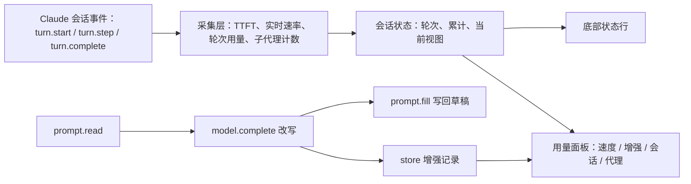

# usage-toolbar

Claude Desktop / Claude Code 的用量与提示词增强 mod：实时生成速度、首字延迟、当前会话累计用量、子代理独立统计，以及提示词增强与增强记录。

本项目参考社区插件 [zcode-token-usage-statusbar](https://github.com/ByteRax/zcode-token-usage-statusbar) 的功能设计，使用 Claude 官方 mod 机制实现，不修改宿主程序文件。

## 功能

| 功能 | 说明 |
|---|---|
| 实时速率 | 生成过程中在输入框下方状态行显示估算速度（t/s）、本轮 token、会话 token 与上下文占比 |
| 状态轮播 | 输入框上方左侧显示彩色点阵球 + 已用时间 + 趣味语录，每 5 秒换一句；支持 `{elapsed}`、`{tps}`、`{model}` 占位符；空闲时显示「本轮工作已完成」 |
| 生成速度明细 | 面板展示最近轮次平均速度、峰值、最低、最新，以及每轮字符柱状图 |
| 提示词增强 | 输入框上方「✦ 增强」或 `/enhance`，用当前会话模型改写草稿并写回，记录原文、增强文、token 与耗时 |
| 当前会话累计 | 输入/输出/缓存读取/缓存写入、请求次数、轮数、平均耗时、平均延迟、平均速度、估算费用、模型明细 |
| 子代理用量 | 子代理独立统计，不计入会话累计；显示每个子代理的状态、模型、token、请求数与速度 |

## 界面与使用

- **输入框上方**：左侧为状态轮播；右上方 `✦ 增强`（改写当前草稿）、`▦ 用量`（打开用量面板）
- **底部状态行**：生成中显示实时估算速度；结束后不显示速率，只保留本轮/会话 token 与上下文占比，例如 `本轮 327 · 会话 289.9万 · 上下文 12%`
- **`/usagebar`**：打开用量面板（宿主已保留 `/usage`，因此命令名为 `usagebar`）
- **`/enhance`**：增强当前输入框草稿
- **面板四个视图**：速度、增强、会话、代理；面板以对话框形态打开，Esc 关闭

### 状态轮播

- 生成中：ZCode 同款单行立体点阵球（三个盲文字符拼出球体，逐帧滚动）+ 已用时间 + 趣味语录；每 250 毫秒滚动一帧，每秒刷新计时，每 5 秒换一句；不额外占高度。
- 语录词库在 `hooks/register.tsx` 的 `TICKER_PHRASES`，可直接增删句子。
- 语录支持占位符 `{elapsed}`、`{tps}`、`{model}`。
- 空闲时显示「本轮工作已完成，随时可以继续」，不显示速率；尚未开始过轮次时显示「准备就绪」。

## 数据口径

| 指标 | 数据来源 | 口径说明 |
|---|---|---|
| 实时速度 | `turn.step` 的 `text` 流式块 | 字符增量 ÷ 3.5 ≈ token，再除以已生成时间；是**估算值** |
| 首字延迟 | `turn.step` 首个 `text`/`thinking` 块 | 首个块到达时间 − 该步请求开始时间 |
| 每轮速度 | `turn.complete.usage.output_tokens` | 输出 token ÷ 各步纯生成耗时之和，不含工具等待 |
| 会话累计 | `turn.complete.usage` 逐轮累加 | 只统计主循环；中断或 API 错误时缺失的 usage 按 0 处理 |
| 请求次数 | `turn.step` 次数 | 每个 `turn.step` 对应一次模型请求 |
| 轮数 | `turn.complete` 次数 | 主循环与子代理分开计数 |
| 平均耗时 | `turn.complete.durationMs` | 整轮墙钟时间，含工具执行间隙 |
| 上下文占比 | `$.session.usage().context.percent` | 最近一次响应的输入侧占模型窗口比例 |
| 估算费用 | `$.session.usage().cost.usd` | 宿主 `/cost` 的本地估算，不是账单；第三方模型可能显示「不可得」 |
| 子代理用量 | `$.agent.list()` + `turn.step` 的 `agentId` | `tokenCount`/`usage`/`cost` 来自 AgentInfo，请求数与轮数自行计数 |
| 提示词增强 | `$.prompt.read()` → `$.model.complete()` → `$.prompt.fill()` | 独立调用，不带会话上下文，成本更低；写回前二次读取草稿，用户改过则不覆盖 |



## 安装

前置条件：Claude Desktop / Claude Code 2.1.326 或更新版本；不需要 Node.js，也没有第三方依赖。

### 方式一：桌面端插件界面（日常使用推荐）

1. 在 Claude Desktop 输入框旁点击 `+`，选择 **Plugins**。
2. 选择 **Add marketplace**，填入以下之一：
   - 本地源码目录：`F:\claude-usages-toolbar`
   - 已发布的 GitHub 仓库：`<owner>/<repo>`
3. 在列表中找到 `usage-toolbar`，选择 **Add plugin**，安装范围选 **user**（当前用户的所有会话可用）。
4. 如果没有立即出现，重新打开一个会话。

> Desktop 的 Code tab 输入框不支持 `/plugin` 命令；请用上面的界面操作，或在终端里安装。

### 方式二：终端安装（本地文件夹或 GitHub）

本地文件夹：

```bash
claude plugin marketplace add F:\claude-usages-toolbar
claude plugin install usage-toolbar --marketplace usage-toolbar-local
```

GitHub 仓库（发布后）：

```bash
claude plugin install usage-toolbar --marketplace <owner>/<repo>
```

安装到 user scope 后，每个新会话都会加载；已打开的会话可以用 `/reload-plugins` 重新读取。

### 方式三：开发调试（当前会话热重载）

任选一种：

1. 复制到本会话的 mod 目录：`~/.claude/dev-mods/<session-id>/usage-toolbar/`，宿主会自动热重载。
2. 启动时指定：`claude --plugin-dir F:\claude-usages-toolbar`。
3. 在用户级 `~/.claude/settings.json` 的 `env` 中设置：

```json
{ "CLAUDE_CODE_PLUGIN_DIRS": "F:\\claude-usages-toolbar" }
```

第一次加载 mods 时，需要允许「Turn on the mods Claude writes in this session?」。

> 正式安装后，不要再让 dev-mods 中的同名副本同时加载，避免重复 hook。保留一种加载方式即可。

### 验证安装

- 输入框上方出现彩色点阵球（生成中）或「✓ 本轮工作已完成」。
- 输入框上方右侧出现 `✦ 增强`、`▦ 用量`。
- 执行 `/usagebar` 能打开用量面板。
- `claude plugin validate F:\claude-usages-toolbar` 返回 `Validation passed`。

### 更新与卸载

- 更新：替换源码后重新安装，或让热重载重新加载；已安装的副本需要重新 Add plugin 或 `claude plugin update usage-toolbar`。
- 卸载：在 Plugins 列表中移除 `usage-toolbar`；或终端执行 `claude plugin uninstall usage-toolbar`（以当前 CLI 支持为准）。同时删除 dev-mods 中的调试副本（如存在）。

## 文件结构

```
.
├── .claude-plugin/
│   ├── plugin.json        # mod 清单
│   └── marketplace.json   # 本地 marketplace 清单
├── hooks/
│   ├── hooks.json         # 模块声明
│   └── register.tsx       # 采集、增强、绘制、命令
├── types/
│   └── index.d.ts         # 状态契约
├── README.md
└── LICENSE
```

`.claude-plugin/types/` 是宿主加载 mod 时生成的类型目录，不应提交到版本库（已加入 `.gitignore`）。

> 注意：`read`/`update` 引用的 atom 必须与 atom 定义在同一模块，这是引擎静态扫描的约束，因此实现集中在 `hooks/register.tsx`。

## 开发与验证

```bash
# 校验清单、hooks 与 TypeScript 类型
claude plugin validate <本目录>

# 类型检查（先让 mod 加载一次，生成 .claude-plugin/types/tsconfig.json）
tsc -p <本目录>
```

- 保存文件后，热重载在本次回合结束或新会话时生效。
- 调试日志：用 `claude --debug` 启动，或查看会话 transcript 中 `usage-toolbar:` 开头的行。
- 当前未提供 `*.test.ts`；如需回归测试，可使用 `claude plugin test <本目录>`。

## 已知限制

- `/usage` 是 Claude Code 内置命令，本 mod 使用 `/usagebar`。
- 实时速度是字符估算，真实值在每步或每轮结束时回填。
- 费用是宿主 `/cost` 的本地估算，不是账单；第三方模型可能没有已知价格。
- 子代理请求次数由 `turn.step` 自行计数，宿主不提供现成字段。
- 回答末尾速率行未实现：`TurnDuration` 只在终端 surface 触发，Desktop 不绘制。
- 面板按窄侧栏约 30 列优化；更宽时内容会留白，不会溢出。

## 许可

MIT License，见 [LICENSE](LICENSE)。

## 致谢

功能设计参考 [ByteRax/zcode-token-usage-statusbar](https://github.com/ByteRax/zcode-token-usage-statusbar)（MIT）。
